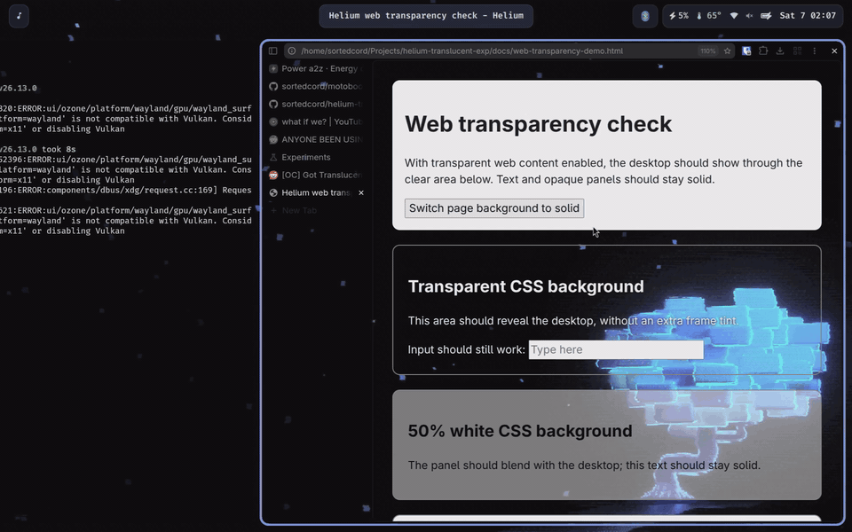

# Helium: With Transparency

This fork adds configurable transparency and compositor blur to Helium for Linux
on Wayland, with separate controls for browser UI opacity, blur, and website
transparency. The tab strip, toolbar, and transparent webpage backgrounds can
show the desktop behind the window. Webpages keep an opaque backing by default;
website transparency is opt-in and respects the site's CSS. Text, images, and
browser controls keep their normal opacity. These features are off by default.

## Demo

[](docs/media/transparency-demo.mp4)

Animated preview — click it to [watch the full-resolution recording](docs/media/transparency-demo.mp4).

The patch targets Helium Linux `0.20.3.1`, shared Helium commit
`2f81b9cafa38a95071e20de3f9cd6b0aca6d3c65`, and Chromium `156.0.8078.79`.
It requires a native Wayland session and client side browser decorations. The
compositor blends transparent pixels with the desktop. An optional blur request
is available on compositors supporting `ext-background-effect-v1`.

## What changed

The Linux patch is [`patches/helium/linux/wayland-frame-opacity.patch`](patches/helium/linux/wayland-frame-opacity.patch), registered in `patches/series`.

- Adds an opacity control to **Settings → Appearance**, applied live, plus
  `helium://flags` and the launch switch `--helium-frame-opacity=VALUE`, which
  take precedence. See [Settings](#settings).
- Reuses Helium's native material hooks to let the browser UI backgrounds
  show through. On Linux, ordinary browser windows paint one theme-colored
  tint at the requested alpha. Caption text and icons stay opaque.
- Enables client side decorations for the affected window. This is needed to
  draw the translucent browser UI when system decorations are selected.
- Clears Chromium's opaque-region hint for this window so Wayland composites
  its per-pixel alpha correctly.
- Keeps `ContentsWebView` and the renderer's page background opaque. This
  includes loading views and pages whose CSS background is transparent, unless
  the separate web-content transparency option is enabled.
- Adds an optional Wayland background-blur request in
  [`wayland-frame-blur.patch`](patches/helium/linux/wayland-frame-blur.patch).
  Ozone binds the compositor's background-effect protocol, owns the effect with
  the surface, and commits blur regions using the same scale conversion as
  input and opaque regions. The outer region follows the window shape;
  page content covers the effect with its opaque backing.
- Adds [web-content transparency](patches/helium/linux/wayland-web-content-transparency.patch).
  With that option enabled, the browser clears its page backing and renderer
  default background to transparent. Rounded page shapes are excluded from the
  browser UI tint, including in split views. Website CSS is not rewritten.
- Adds [Settings → Appearance controls](#settings) for opacity, blur, and website
  transparency, stored as per-profile prefs, in
  [`wayland-settings.patch`](patches/helium/linux/wayland-settings.patch). Changes
  apply to open windows without a relaunch.
- Adds a Safari-style [page-slide swipe for history navigation](#slide-pages-when-swiping)
  on the touchpad, in
  [`wayland-swipe-page-preview.patch`](patches/helium/linux/wayland-swipe-page-preview.patch),
  with a toggle in **Settings → Behavior**.

- Makes Chromium see the battery on Linux, in
  [`linux-battery-energy-saver.patch`](patches/helium/linux/linux-battery-energy-saver.patch).
  Battery state comes from `/sys/class/power_supply`, and AC or battery status
  from UPower. **Settings → Performance → Energy saver** therefore appears on
  Linux, and its "when unplugged" and "low battery" rules work. The system
  power-saver profile (power-profiles-daemon) also turns Energy saver on, when
  the Energy saver toggle is on.
- Makes fullscreen windows opaque, in
  [`wayland-fullscreen-opaque.patch`](patches/helium/linux/wayland-fullscreen-opaque.patch).
  While a window is fullscreen the transparency and blur are dropped and the
  window is declared opaque. The compositor then skips blending it, and can
  scan fullscreen video out directly. The transparency comes back on exit.

The shared Helium [native materials patch](helium-chromium/patches/helium/ui/native-frame-materials.patch) contains the existing UI painting hooks. The Linux patches extend those hooks with Wayland compositing and website transparency.

## Build

Build from the repository root with Docker. The provided image supplies the
Debian build dependencies; Docker must be installed and accessible to your user.

```sh
git clone --branch main --recurse-submodules \
  https://github.com/sortedcord/helium-translucent-wayland.git
cd helium-translucent-wayland
scripts/docker-build.sh -c
```

The `-c` option builds from a Chromium source checkout and applies the pinned
Helium and Linux patch series. A complete Chromium build needs substantial disk
space, memory, and time.

To package the completed build into a tarball and AppImage using the packaging
container:

```sh
package/docker-package.sh
```

The resulting tarball and AppImage are written under `build/release/`. A Debian
package can be requested with `MAKE_DEB=1 package/docker-package.sh`.

Before compiling, you can check that the patch applies to the pinned upstream
files without downloading all of Chromium or building:

```sh
python3 scripts/check-frame-opacity-patch.py
python3 scripts/check-frame-opacity-patch.py --patch helium/linux/wayland-frame-blur.patch
python3 scripts/check-frame-opacity-patch.py --patch helium/linux/wayland-web-content-transparency.patch
python3 scripts/check-frame-opacity-patch.py --patch helium/linux/wayland-web-content-lifecycle.patch
python3 scripts/check-frame-opacity-patch.py --patch helium/linux/wayland-settings.patch
python3 scripts/check-frame-opacity-patch.py --patch helium/linux/wayland-swipe-page-preview.patch
```

## Settings

On native Wayland, **Settings → Appearance** shows three controls, below the
rounded-frame option, and **Settings → Behavior** shows the page-slide swipe
toggle (see [Slide pages when swiping](#slide-pages-when-swiping)). They are
hidden on X11 and other platforms.

| Control | Range | Default |
|---|---|---|
| **Browser window opacity** | Slider, 0–100% in 5% steps | 100% |
| **Blur behind the window** | Toggle | Off |
| **Transparent website backgrounds** | Toggle | Off |

They are per-profile prefs (`helium.browser.wayland_frame_opacity`,
`helium.browser.wayland_frame_blur`, and
`helium.browser.wayland_transparent_web_content`). Changing one applies to every
open window of that profile, with no relaunch: the frame type, opaque and blur
regions, each tab's default page background, and the frame tint are refreshed.
Blur strength cannot be set here, because the Wayland protocol exposes none; set
it in your compositor (see [blur strength on niri](#blur-strength-on-niri)).

The launch switches and `helium://flags` entries below still work and **override**
the Settings values when present, which is useful for scripted or test launches.
Leave a flag on **Default** to use the Settings value. If an opacity flag was
previously enabled in `helium://flags`, reset it to Default so the Settings slider
can take effect. Flags and switches are read at startup.


## Energy saver on Linux

Energy saver is in **Settings → Performance**. It needs no setup: Helium reads the
battery from sysfs and UPower. Each rule works as follows:

- **Turn on when your computer is unplugged** or **Turn on at 20% battery**: as
  on other platforms.
- **System power-saver profile**: when power-profiles-daemon is in `power-saver`
  (`powerprofilesctl get`), Energy saver turns on too, whichever rule you chose,
  as long as the Energy saver toggle is on. Switching the profile back turns it
  off again.

Energy saver throttles background tabs, limits frame rates and reduces timer
frequency. With the Energy saver toggle off, the power-saver profile has no
effect on Helium.

## Slide pages when swiping

On native Wayland, a two-finger horizontal swipe on the touchpad slides the page
with your fingers, like Safari on macOS. The pages behave as a stack: going back,
the current page slides to the right and uncovers the previous page, which stays
still; going forward, the next page slides in from the right over the current
page, which stays still. A soft shadow falls from the moving page's edge. Release
past the commit point to navigate, or earlier to snap back. The browser chrome
stays in place; only the page area moves. Without this, Chromium only shows a
small arrow and then navigates.

Turn it off in **Settings → Behavior → Slide pages when swiping** (on by
default; the option is hidden outside Wayland). It is stored as the per-profile
pref `helium.browser.wayland_swipe_page_preview`. It affects touchpad swipes
only; touchscreen swipes and pull-to-refresh are unchanged, and Chromium's own
swipe-between-pages option still gates the gesture.

How it works, and its limits:

- A snapshot of a page is captured when you navigate away from it, and again when
  a swipe starts. Snapshots are kept in a memory-bounded cache (about 190 MB for
  the whole browser) and are dropped with their tab. Same-page (fragment or
  `pushState`) navigations cannot be captured reliably after the fact, so such an
  entry only has a snapshot if you swiped away from it. When there is none, the
  page slides over a plain themed background.
- The page moves at 0.3× the swipe distance and follows your fingers across its
  full width. Whether a release navigates is still Chromium's rule (a fixed swipe
  distance, 30% of the screen size), not a fraction of how far the page has moved.
- With **Transparent website backgrounds** on, the slide stays translucent: the
  real page is hidden while snapshots stand in for it, no opaque background is
  painted, and the page underneath is clipped to the strip the top page has
  uncovered, so the desktop (not the other page) shows through transparent
  areas. With it off, the slide is drawn over a solid themed background.

## Set the opacity

Use **Settings → Appearance → Browser window opacity**, or open
`helium://flags/#helium-frame-opacity`, choose an opacity, and relaunch the
browser. Available values range from fully opaque to clear. At `0`, the browser UI
background tint is invisible while text, icons, and controls remain visible.
The default is fully opaque.

Alternatively, pass an opacity at launch:

```sh
helium --ozone-platform=wayland --helium-frame-opacity=0.8
```

The value is a number from `0` to `1`; for example, `0.8` means 80% opacity.
Malformed, nonfinite, or out-of-range switch values fall back to fully opaque.
With no switch, the Settings value is used. The switch is read at startup, so
close the existing Helium process before relaunching. For the development build,
the executable is `build/src/out/Default/helium`.

Only the browser UI background uses this opacity. Web content remains opaque unless
its separate transparency option is enabled. Custom theme background
images are suppressed while this effect is active, and some floating controls
may retain their own backgrounds.

## Enable or disable blur

Turn on **Settings → Appearance → Blur behind the window**, or open
`helium://flags/#helium-frame-blur`, choose **Enabled** or **Disabled**, and
relaunch. Default makes no blur request. Enable browser UI or website transparency
so the effect can be seen. For example:

```sh
helium --ozone-platform=wayland --helium-frame-opacity=0.8 --helium-frame-blur=1
```

Use `--helium-frame-blur=0` to remove Helium's request. A compositor window rule
that forces blur can override that choice. Fullscreen, app, popup, devtools, and
picture-in-picture windows do not request this effect. Unsupported compositors
keep transparency without blur.

These controls require a build of this fork; standard Helium binaries do not
include them.

### Blur strength on niri

Wayland's background-effect protocol exposes a blur region, but no radius,
strength, or algorithm. Helium therefore cannot set a portable blur-strength
value. Set strength in your compositor. For example, niri 26.04+ accepts this
top-level block in `~/.config/niri/config.kdl`:

```kdl
blur {
    passes 3
    offset 3.0
}
```

Merge these settings into an existing `blur` block if you have one. They affect
**all background blur in niri**, not just Helium. Increasing `offset` makes the
blur broader without adding passes; increasing `passes` can smooth a broader
blur but costs more GPU work. Large offsets can produce artifacts. Niri's
global `blur { off }` disables blur even if Helium requests it.

#### Tips for niri users

- **Blur windows instead of wallpaper:** By default, niri enables `xray` on
  any background effect, which blurs the desktop wallpaper rather than the
  windows stacked underneath Helium. To blur windows behind Helium, add a
  window rule with `xray false` to `~/.config/niri/config.kdl`:
  ```kdl
  window-rule {
      match app-id="^helium$"
      background-effect {
          xray false
      }
  }
  ```
- **Prevent border/focus ring tint bleed:** Niri normally draws focus rings
  and borders with a solid background behind client-side decorated windows.
  To prevent this solid color from tinting the translucent frame:
  ```kdl
  window-rule {
      match app-id="^helium$"
      draw-border-with-background false
  }
  ```

See [niri's blur configuration](https://github.com/niri-wm/niri/wiki/Configuration%3A-Miscellaneous#blur),
[niri's window effects](https://github.com/niri-wm/niri/wiki/Window-Effects),
and the [Wayland background-effect protocol](https://wayland.app/protocols/ext-background-effect-v1).

## Transparent website backgrounds

Turn on **Settings → Appearance → Transparent website backgrounds**, or enable
**Transparent web content on Wayland** at
`helium://flags/#helium-transparent-web-content` and relaunch. Alternatively:

```sh
helium --ozone-platform=wayland --helium-transparent-web-content=1
```

Use `--helium-transparent-web-content=0` to keep the normal opaque backing.
This setting is independent of browser UI opacity: the UI can remain fully opaque
while the page has transparent areas. It applies only to normal browser windows
on native Wayland. Existing binaries need to be rebuilt to include this option.

The feature removes the browser's solid backing behind the page. A page's
`html`/`body` background must also be transparent for the desktop to show
through. A transparent child over an opaque parent still shows that parent's
background. Websites with no background specified may become transparent because
CSS defaults to transparent. Explicit opaque backgrounds still cover the
desktop, and translucent CSS colors blend normally. No page CSS is injected,
and there is no opacity multiplier applied to text or images.

Browser UI opacity and blur may be combined with this setting:

```sh
helium --ozone-platform=wayland --helium-frame-opacity=0.8 \
  --helium-frame-blur=1 --helium-transparent-web-content=1
```

The transparent default is stored on each tab's `WebContents`, so future
renderers inherit it even while the tab is hidden. The page backing is also
reapplied when switching tabs and when the primary page changes. See
[`wayland-web-content-lifecycle.patch`](patches/helium/linux/wayland-web-content-lifecycle.patch).

Open [`docs/web-transparency-demo.html`](docs/web-transparency-demo.html) as a
local file to check clear, translucent, and opaque page regions. Its button
switches the page background between transparent and solid without a reload.
Check it in a restored window, maximized window, and split view; rounded corners
and gutters should retain the browser UI tint. The normal opaque backing should
return when the flag is disabled.

For an automated lifecycle regression check, run these commands on a Wayland
desktop after building. They require Python's Pillow package and the matching
ChromeDriver from the build:

```sh
python3 scripts/check-web-transparency-lifecycle.py
python3 scripts/check-web-transparency-lifecycle.py --opaque
```

The check opens a temporary browser profile with local data pages, switches to
an opaque tab and back, reloads, and navigates again. It checks screenshot alpha
and an opaque CSS panel after every transition. `--pause 30` keeps the other tab
active for 30 seconds before returning. It does not use the existing profile or
change system/browser settings.

## Automatic website transparency: Helium Glass

The companion [Helium Glass extension](extensions/helium-glass/README.md)
analyzes each website's palette and gives its page backgrounds, cards, and
neutral gradients different levels of transparency. Text, images, controls,
and strong accent colors retain their normal opacity. Theme changes and
dynamically added surfaces are detected automatically.

Enable **Transparent web content on Wayland**, open `helium://extensions`,
enable **Developer mode**, and **Load unpacked** from
[`extensions/helium-glass`](extensions/helium-glass). Reload existing pages.
Click the extension icon for a transparency slider, per-site toggle, contrast
protection, and global switch. It runs locally and needs no browser rebuild.

The extension is an experimental automatic restyler. Some sites may need a
lower strength or the site toggle; image backgrounds, pseudo-elements, and
shadow DOM are not rewritten. See its README for installation, permissions,
limitations, and tests, or try the included
[surface demo](extensions/helium-glass/demo.html).

Version 0.2 starts at document creation, prioritizes visible backgrounds, and
locally caches learned page-canvas colors for earlier styling on repeat visits.
Cached fills are checked against the loaded page and replaced by fresh analysis.
The bounded cache expires after seven days and respects site/global opt-outs.

## License

Helium's original license and attribution are preserved. Helium-specific code
and patches use GPL-3.0; see [`LICENSE`](LICENSE). Unmodified imported Chromium
and ungoogled-chromium code keeps its original license; see
[`LICENSE.ungoogled_chromium`](LICENSE.ungoogled_chromium).
